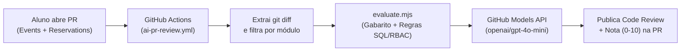

# Capacitação Backend NestJS & Avaliador Automático de PRs com IA 🎟️🤖

> **Plataforma de capacitação técnica e desafio prático de engenharia backend desenvolvida para a EJCOMP (Empresa Júnior de Ciência da Computação — UNESP).**

[](https://nestjs.com/)
[](https://www.typescriptlang.org/)
[](https://www.sqlite.org/)
[](https://jestjs.io/)
[-2088FF?style=for-the-badge&logo=githubactions&logoColor=white)](./.github/workflows/ai-pr-review.yml)

---

## 🎯 Propósito e Contexto do Projeto

Este repositório foi projetado como um **ambiente de treinamento prático e avaliação automatizada** sobre arquitetura backend com **NestJS** para os membros e trainees da **EJCOMP**.

O projeto combina três pilares de engenharia:
1. **Arquitetura Base & Desafio Sem ORM (Raw SQL):** Uma API RESTful para um **Sistema de Reserva de Ingressos e Bilheteria Digital**, onde o uso de ORMs (Prisma, TypeORM, Sequelize) é **estritamente proibido**. Toda a persistência em SQLite é realizada via queries em **SQL puro** com controle manual de transações atômicas, visando ensinar na prática os fundamentos de banco de dados e o ciclo de vida de requisições do NestJS (*Middlewares, Guards, Interceptors, Pipes e Exception Filters*).
2. **Entregas via Pull Request (Módulos de Domínio):** A branch `master` entrega toda a fundação arquitetural pronta (`AuthModule`, `UsersModule`, `DatabaseModule`, `Common` e `DTOs`), cabendo aos participantes implementar os módulos de negócio faltantes (**`EventsModule`** e **`ReservationsModule`**) seguindo a [Especificação Técnica (PDF)](./docs/Requisitos%20e%20Diretorios.pdf) / [(AsciiDoc)](./docs/Requisitos%20e%20Diretorios.adoc) e submeter via Pull Request.
3. **Correção Automatizada por IA + Testes E2E:** Ao abrir uma Pull Request, um pipeline no GitHub Actions executa a validação e aciona um **Agente Avaliador de Código baseado em LLM (`gpt-4o-mini` via GitHub Models)**, que analisa o `git diff` contra o gabarito de requisitos e publica automaticamente um parecer técnico com nota (`0-10`), pontos fortes, pontos de melhoria e checklist de cobertura diretamente na PR.

> 💡 **Quer ver a implementação completa (Gabarito)?**  
> Os módulos `EventsModule` e `ReservationsModule` totalmente implementados estão disponíveis na branch [**`gabarito`**](https://github.com/LeonardoCoradeli/Capacitacao/tree/gabarito) (em [`src/events`](https://github.com/LeonardoCoradeli/Capacitacao/tree/gabarito/src/events) e [`src/reservations`](https://github.com/LeonardoCoradeli/Capacitacao/tree/gabarito/src/reservations)), e um exemplo real da avaliação automática gerada pela IA pode ser consultado na [**Pull Request #1**](https://github.com/LeonardoCoradeli/Capacitacao/pull/1).

---

## 🤖 Como Funciona o Avaliador de PRs com IA

O fluxo de correção contínua está definido em [`.github/workflows/ai-pr-review.yml`](./.github/workflows/ai-pr-review.yml) e [`.github/scripts/evaluate.mjs`](./.github/scripts/evaluate.mjs):



### Exemplo Real de Saída do Bot (extraído da [PR #1](https://github.com/LeonardoCoradeli/Capacitacao/pull/1)):

> ### 🤖 Avaliação Automática — Módulos Events e Reservations
> **Nota final: 9.0/10**
>
> | Módulo | Nota |
> |---|---|
> | Eventos | 9/10 |
> | Reservations | 9/10 |
>
> **✅ Pontos positivos (Reservations)**
> - Implementação de rotas para criar, cancelar e listar reservas conforme o gabarito.
> - Uso de transações para operações que envolvem leitura e escrita atômica (`remaining_seats`).
> - Validação e documentação dos DTOs com Swagger e Guards de autorização.
>
> **📋 Cobertura de requisitos verificada pela IA**
> - `[x]` Decrementar `remaining_seats` atomicamente e rejeitar quando esgotado (`sold_out`)
> - `[x]` Soft delete ao cancelar evento com propagação de `event_status_snapshot = 'cancelled'` nas reservas
> - `[x]` Histórico de reservas do usuário preservando status e snapshot do evento

---

## 🏗️ Arquitetura do Sistema e Ciclo de Vida NestJS

O sistema atende a três perfis de acesso (**RBAC**):
* **`BUYER (0)`** — Explora o catálogo de eventos ativos, realiza reservas de assentos e gerencia seu histórico.
* **`ORGANIZER (1)`** — Cria eventos, monitora lotação e edita/cancela exclusivamente seus próprios eventos.
* **`ADMINISTRATOR (2)`** — Modera a plataforma, gerencia permissões de usuários (`PATCH /users/:id/role`) e pode cancelar qualquer evento.

### Camadas Implementadas (`src/`)

```text
src/
├── auth/                  # Autenticação JWT, RolesGuard (@Roles) e JwtAuthGuard
├── common/
│   ├── filters/           # AllExceptionsFilter (padronização global de erros HTTP)
│   ├── interceptors/      # ResponseTransformInterceptor (Envelope JSON), AuditLogInterceptor e TimeoutInterceptor
│   ├── middleware/        # TraceIdMiddleware (X-Trace-Id UUID v4) e LoggerMiddleware
│   └── types/             # Enums de Role, EntityStatus e interfaces de linhas SQLite
├── config/                # Validação estrita de variáveis de ambiente no bootstrap
├── database/              # DatabaseService com SQLite (better-sqlite3), criação de tabelas e transações SQL puras
├── dto/                   # Contratos de entrada/saída com class-validator, Swagger e custom validator (@IsFutureDate)
├── users/                 # Gestão de usuários, cadastro público, atualização de perfil e alteração de cargos
├── events/                # [Desafio / Branch 'gabarito'] CRUD de eventos, cálculo de assentos e soft delete em cascata
└── reservations/          # [Desafio / Branch 'gabarito'] Reserva atômica de vagas, cancelamento e histórico
```

---

## 🧪 Suíte de Testes E2E e Property-Based (`test/`)

O repositório conta com **mais de 35 arquivos de especificação E2E** utilizando **Jest**, **Supertest** e **Fast-Check (Property-Based Testing)** em [`test/`](./test):

* **`test/auth/`** — Validação de token JWT, tempo de expiração, rejeição de credenciais inválidas e verificação estrita de *roles*.
* **`test/users/`** — Persistência de cadastro, bloqueio de logins duplicados, limites de payload e alteração de cargos por administradores.
* **`test/events/`** — Inicialização de assentos, recálculo de `remaining_seats`, flag de `sold_out`, cancelamento autorizado e propagação de status para reservas.
* **`test/reservations/`** — Decremento atômico de vagas, bloqueio de reservas duplicadas ou em eventos passados/cancelados e devolução de assento no cancelamento.
* **`test/cross-cutting/`** — Formato do `traceId`, envelope de resposta padronizado, preservação de *soft delete* e rejeição de UUIDs malformados.

---

## 🚀 Como Executar Localmente

### Pré-requisitos
* **Node.js** (v20+ recomendado)
* **npm**

### Passo a passo

```bash
# 1. Clone o repositório
git clone https://github.com/LeonardoCoradeli/Capacitacao.git
cd Capacitacao

# (Opcional) Para testar a versão com todos os módulos prontos:
# git checkout gabarito

# 2. Instale as dependências
npm install

# 3. Configure as variáveis de ambiente
cp .env.example .env

# 4. Inicie o servidor em modo de desenvolvimento
npm run start:dev
```

A documentação interativa **Swagger (OpenAPI)** ficará disponível em `http://localhost:3000/api` (ou na porta definida no `.env`).

### Executando os Testes

```bash
# Executar toda a suíte de testes E2E e Property-Based
npm run test:e2e
```
